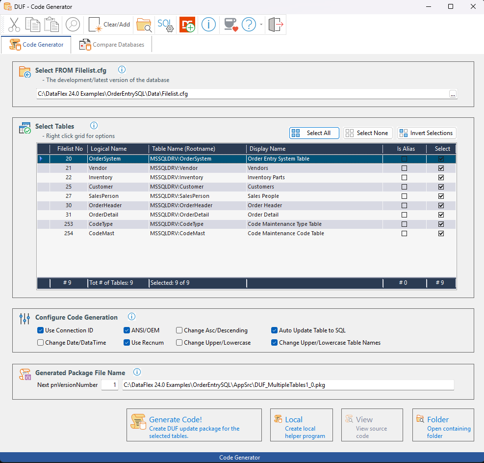
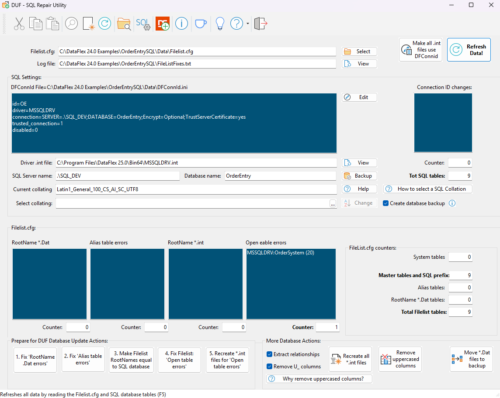

### DUF - Database Update Framework for DataFlex

It is highly recommended to download and install the GitHub Desktop app, as it will significantly simplify your work. You can download it via this link: https://desktop.github.com/download/.

Once installed, click the "<> Code" button at this GitHub page and select "Open with GitHub Desktop." This will install the complete repository in your chosen download location.

Note: Do not select "Download ZIP," as GitHub will not include the libraries used by the workspace, and you would need to download them manually, which can be cumbersome!

The Database Update Framework (DUF) is a code-based solution designed for automating database updates. It streamlines the process of updating databases at customer sites, particularly when installing a new software version that requires prior changes to the database.

[Click here to see the Introduction Video on YouTube](https://www.youtube.com/watch?v=D2o0zjPEr_I)

[Watch a more in-depth video about the framework](https://www.youtube.com/watch?v=VD4eN9oP0_U)

### Programs to Compile and Use

To implement the framework, you will need to compile and use two programs:
- **DUFCodeGenerator**
- **DUFSQLRepairUtility**

Additionally, you need to integrate a piece of code into your program to facilitate the automated database update. This can be done by selecting a `cDbUpdateHandler` object from the Studio's Class Palette and dragging it into your main program.

It is recommended to add the `DUFCodeGenerator.exe` and `DUFSQLRepairUtility.exe` programs to the Studio’s Tools menu. You can do this by executing the programs and clicking the “Add To Studio” button.

### Important Information

Before proceeding, please read the following help sections:
- “Welcome to the Database Update Framework”
- “Workspace Setup”
- “How to Use It”

These sections can be found in the `Developer5.chm` Help file located in the `/Help` folder. Alternatively, you can press F1 while running one of the programs for assistance.





The workspace also uses three other libraries from Nils Sve's GitHub page — DFAbout, RDCToolsLib and vwin32fh. As of the flattening described below, they are **no longer nested submodules of DUF**; they are separate sibling libraries. See the Dependencies section for why, and what a consuming application must do.

## Setup after cloning

**Building DUF on its own** (working on the framework itself): after cloning, run **`setup.bat`**
once from the repository root. It clones DFAbout, RDCToolsLib, vwin32fh and DFUnit as **siblings** of the
DUF folder — the layout the `DUFDev*.sws` workspaces expect (19.1, 20.1, 23.0, 24.0, 25.0 and 26.0). Open the one
of your DataFlex version to build. Re-run `setup.bat` any time those sibling folders look missing or stale.

There is no plain `DUF25.0.sws`. The two workspace files are named for their role, so it is
always clear which to use:

| File | Role | `[Libraries]` |
|---|---|---|
| `DUFDev19.1.sws` / `20.1` / `23.0` / `24.0` / `25.0` / `26.0` | Open this to **develop** DUF | the `..\` siblings |
| `DUFLibrary19.1.sws` / `20.1` / `23.0` / `24.0` / `25.0` | A consumer **references** this | none — deliberately empty |

On DataFlex 19.1 three of the five programs build: `DUFTestProgram`, `ReadDFDriverDefXML` and
`DUFSQLRepairUtility`. `DUFCodeGenerator` needs DataFlex 20.1 or later, and `DUFSQLConnections` needs the
icon `TagRemove.ico`, which DataFlex ships from version 20.

### Unit tests

`AppSrc\UnitTests.src` is the unit-test program of the workspace, built on
[DFUnit](https://github.com/NilsSve/Library-DFUnit). The tests are in `AppSrc\o<Subject>-Tests.pkg`, one file
per subject, and `AppSrc\oUnit_Tests.pkg` lists them. The first file, `oDbUpdateFunctionLibrary-Tests.pkg`,
covers helper functions that need no database.

- **DataFlex 26:** `DUFDev26.0.sws` takes DFUnit as a package.
- **DataFlex 19.1 to 25:** `DUFDev<version>.sws` takes it from the sibling folder `..\DFUnit`, which
  `setup.bat` clones.

Compile `UnitTests` and run it: the test-runner window opens. `UnitTests64.exe -c` runs the tests without a
window and ends with exit code 0 when all passed; `-o result.xml` adds a JUnit file. On DataFlex 19.1 the
program is `UnitTests.exe`.

`DUFLibrary*.sws` declaring no libraries is the point: when DUF is used as a library inside
another application, that application supplies the four-library flat set itself (see below), and
DUF must not drag its own copies onto the path. (The old single `DUF25.0.sws` had the empty
consumer file wearing the plain, inviting name — so it was the one people opened to work on DUF,
found no libraries, and hit a wall. Two role-named files remove that trap.)

That is the only setup step. In particular `Help\About.rtf` now ships with the repository — it
used to be gitignored, which meant a fresh clone could not compile at all until someone worked
out that `DfAbout.pkg` embeds that file as a program resource. What is committed is a minimal
placeholder; replace its text with whatever the About dialog should show, but do not delete the
file. Editing it in Word rewrites the whole thing, so expect whole-file diffs.

## Dependencies

DUF requires **RDCToolsLib**, **vwin32fh** and **DFAbout**. What each is actually for:

| Library | Why DUF needs it |
|---|---|
| RDCToolsLib | The `cRDC*` control classes and `RDCStatusPanel.pkg`, used throughout the dialogs and `cBaseDbUpdateFuncLib`. |
| vwin32fh | `vWin32fh.pkg`, used directly by `cBaseDbUpdateFuncLib` — and required by RDCToolsLib in its own right. |
| DFAbout | One class: `SysInfoDialog`, shown by `DriverSettings.dg`. Nothing else in DUF touches DFAbout. |

Note the shape of that last row. DUF is a database library, and its entire dependency on the
About-dialog library is a single System Information popup in one dialog. If DUF's dependency
list ever needs to get shorter, extracting `SysInfoDialog` into RDCToolsLib is the move.

### DataFlex 26: DUF as a package, and its programs

On DataFlex 26 DUF can be added to a workspace as a package (`RDC-DUF-Library.sws`). DFAbout, RDCToolsLib and
vwin32fh come with it. A package brings the sources of DUF's programs, but no programs.

The package puts **`BuildDUFUtilities.bat`** into the workspace folder. Start it there. It compiles
`DUFCodeGenerator` and `DUFSQLRepairUtility` into the workspace's `Programs` folder:

- with the login key of that workspace (`AppSrc\LoginEncryptionKey.inc`), which a program built somewhere
  else does not have;
- with the DataFlex version the workspace file names, 64-bit, with icon and manifest as the Studio builds them.

`BuildDUFUtilities.bat /all` also builds `DUFSQLConnections` and `ReadDFDriverDefXML`. With several workspace
files in the folder, name the one to build for: `BuildDUFUtilities.bat MyApp.sws`. Run it again after the
package is updated.

It is a plain batch file and needs only Windows and DataFlex. It finds `df-cli.exe` on the PATH or through the
registry, or takes its path from the variable `DFCLI`. It writes to `Programs` and to a folder
`DUFUtilitiesBuild` in the workspace, which holds the compiler's listings and can be deleted. The package
folder in `DfPkg` is only read.

If the script cannot run on a machine, this is what it does for each program, from the workspace folder:

```
"C:\Program Files\DataFlex 26.0\Bin64\df-cli.exe" build-file "DfPkg\NilsSve_RDC_DUF_Library-<version>\AppSrc\DUFCodeGenerator.src" --workspace MyApp.sws --output-dir Programs --toolchain 26.0.0+windows-64
```

That one command builds the program without its icon and manifest; the script adds both.

### Passwords in SQLConnections.ini

DUF encrypts the passwords in its `SQLConnections.ini` file with the login key of the workspace: the file
`AppSrc\LoginEncryptionKey.inc`, which the Studio makes once for each workspace. It is the key DataFlex itself
uses for `DFConnId.ini`. `cSQLConnectionIniFile` takes the key from the first of these that gives one:

1. `psHashString`, when the program has set it. It is empty by default.
2. `AppSrc\LoginEncryptionKey.inc` of the workspace the ini file is in, read when the program runs. That file
   is there on a development machine, so a DUF utility built in another workspace reads an application's file
   with the application's key.
3. The login key the program was compiled with.

Three things follow:

- Every program that uses `cSQLConnectionIniFile` needs `AppSrc\LoginEncryptionKey.inc` when it is compiled.
- **Existing files:** passwords stored before this change were encrypted with a fixed value in the class.
  They are not read any more. Enter them again, with the connections manager or the application's dialog.
- On a machine without the application's source, a customer's for one, only a program built with the
  application's login key reads its file. Build a utility that goes there in the application's workspace;
  on DataFlex 26 `BuildDUFUtilities.bat` does that.

### If you are consuming DUF from an application

Add all four — DUF, RDCToolsLib, vwin32fh and DFAbout — as submodules under your application's
`Libraries\`, and declare them as a flat sibling list in your application workspace's
`[Libraries]`. Do not rely on reaching the three through DUF; DUF's consumer `.sws` declares no
libraries precisely so that it cannot.

There are two reasons, and both are things this project has actually been bitten by:

1. **Version drift.** DataFlex resolves the compiler search path first-match-wins, with no version
   arbitration. If a library reached the path from two different checkouts, list order alone would
   decide which won, silently. One library, one checkout, declared by the application, is the only
   arrangement that cannot drift.

2. **The Studio navigates by disk, not by the path.** Even when the *build* is unambiguous, a
   second physical copy of a package on disk means Go-to-Definition and Find-in-Files can land on
   the wrong file — and you can edit one copy while the build compiles the other. Flat siblings
   mean exactly one physical copy of each library, so that cannot happen.

This is why DUF stopped nesting the three: nesting guaranteed a second physical copy inside every
consumer that also declared them as siblings. **Migrating a consumer:** add the three as siblings,
list all four flat in the workspace, and confirm there is no longer a
`Libraries\DUF\Libraries\` folder shadowing them.
